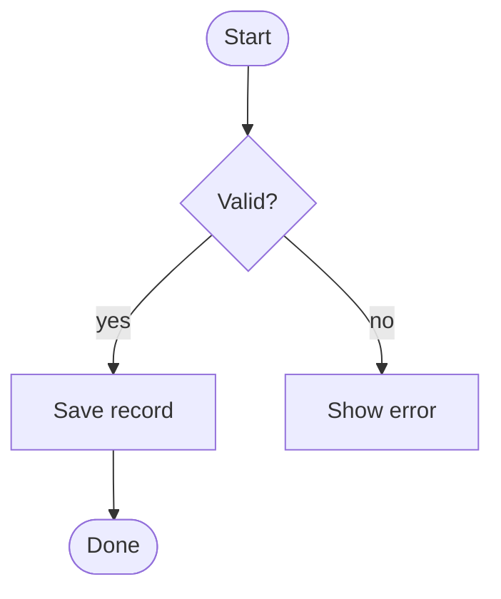
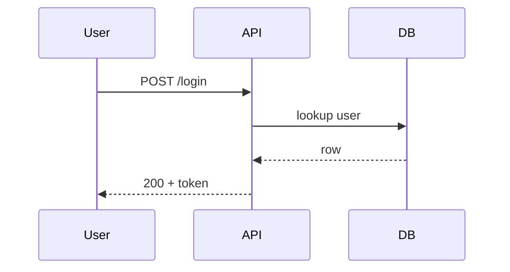
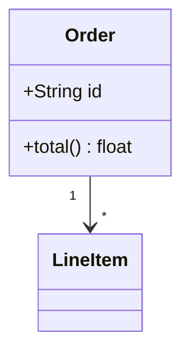
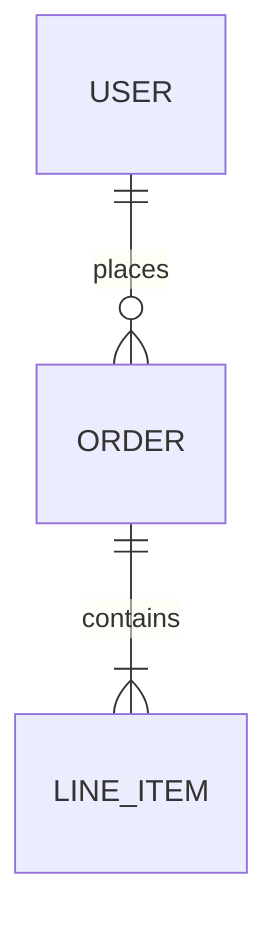
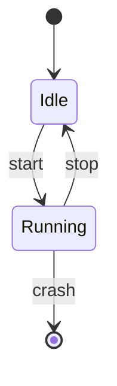

# Diagram — clear Mermaid diagrams that render the first time

Take whatever the user wants explained visually — a process, a system, a data model, a sequence of calls, a state machine, a chunk of their code — and produce a **correct, readable Mermaid diagram**. The win condition is a diagram that renders without errors and makes the structure obvious at a glance, not a wall of nodes.

## Step 1: Understand what you're drawing

If the subject is **code or an existing system**, read it first — don't guess the flow. Trace the real call path, the real states, the real relationships. A diagram that's confidently wrong is worse than none.

If the subject is **an idea the user described**, restate it in one line to yourself so the diagram matches their mental model. Ask a short clarifying question only if a fork would change the whole diagram (e.g. "is this the login flow or the signup flow?"). Otherwise decide and go.

## Step 2: Pick the diagram type

Match the type to the *shape* of the information:

| The user is showing… | Use |
|---|---|
| Steps, decisions, branching logic, a process | `flowchart` (TD top-down, or LR left-right) |
| Messages/calls between actors over time | `sequenceDiagram` |
| Objects, fields, methods, inheritance | `classDiagram` |
| Database tables / entities and their relations | `erDiagram` |
| A thing that moves between states on events | `stateDiagram-v2` |
| A schedule / timeline with durations | `gantt` |
| Branching ideas around a central topic | `mindmap` |
| A person's steps + how they feel at each | `journey` |
| Branches, merges, commits | `gitGraph` |
| High-level services/boxes and how they connect | `flowchart` with `subgraph`s (good enough for most "architecture" asks) |

When in doubt between flowchart and sequence: if **who talks to whom and in what order** matters, it's a sequence diagram; if **what happens next and which branch** matters, it's a flowchart.

## Step 3: Write Mermaid that actually renders

Most Mermaid failures come from a handful of avoidable mistakes. Follow these and it renders first try:

- **Quote any label with special characters.** Parens, colons, commas, slashes, `#`, `&`, or HTML-ish text break the parser. Wrap the label in double quotes: `A["process(input)"]` not `A[process(input)]`.
- **Node IDs are bare identifiers; display text goes in the brackets.** `userDB[("User DB")]` — `userDB` is the id, the quoted bit is shown.
- **Don't reuse a node ID for two different nodes.** Mermaid merges them.
- **One edge per line.** Don't chain more than is readable; break long chains.
- **`<br/>` for line breaks inside a label**, not a real newline.
- **In `sequenceDiagram`, declare participants** in the order you want them left-to-right if the auto order looks wrong.
- **Avoid reserved words** (`end`, `class`, `state`, `click`, etc.) as bare node IDs — capitalize or suffix them (`End1`, `endNode`).
- **Keep it legible:** if it's past ~20–25 nodes, split into multiple diagrams or use `subgraph`s. A diagram no one can read failed its only job.
- **Direction:** `flowchart LR` for wide/pipeline flows, `TD` for hierarchies and decision trees.

Sanity-check the syntax in your head before saving. If unsure whether a construct is valid, prefer the simplest form that works over a fancy one that might not.

## Step 4: Save it and show it

1. Write the diagram to a **`.mmd`** file. Default location: the project if the diagram documents the project (e.g. `docs/<name>.mmd` or alongside the code it describes); otherwise the scratchpad directory. Name it for its subject (`auth-flow.mmd`, `order-state-machine.mmd`).
2. **Render it for the user with `SendUserFile`, passing `display: "render"`** — the app renders Mermaid inline, so they see the actual diagram, not just text.
3. In your reply, also paste the Mermaid in a fenced ```mermaid block so it's copy-pasteable into GitHub/Notion/docs, and give one or two lines explaining what the diagram shows. Keep prose short — the diagram is the deliverable.

If the user asked for the diagram to live in a specific doc or README, put it there in a ```mermaid fence instead of (or in addition to) the `.mmd` file.

## Reference — minimal skeletons

Flowchart:


Sequence:


Class:


ER:


State:


Deliver a diagram that renders and reads clearly. That's the whole job.
